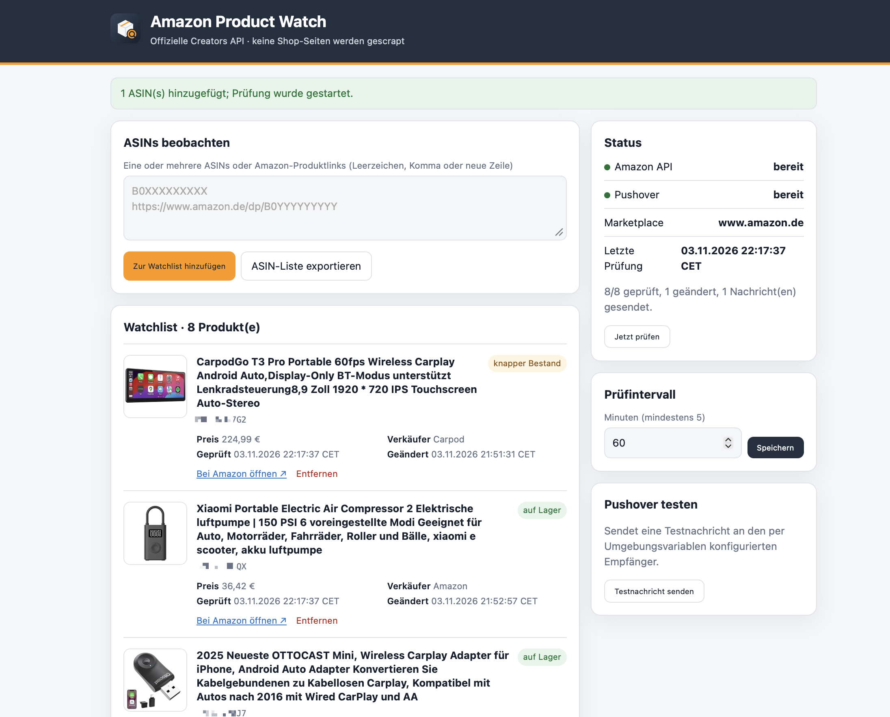

# Amazon Product Watch

Eine ZimaOS-/Docker-App, die beliebige ASINs über Amazons **offizielle Creators API** beobachtet und bei Änderungen Pushover-Nachrichten sendet. Die App liest keine Amazon-Shopseiten aus und benötigt keinen Browser-Scraper.

Die Weboberfläche läuft standardmäßig auf Port **8644**. Dort lassen sich ASINs oder komplette Amazon-Produktlinks hinzufügen, entfernen und sofort prüfen.

## Motivation

Amazon Affiliates sollten regelmäßig prüfen, ob ihre beworbenen Produkte noch verfügbar sind und von der offiziellen API weiterhin mit einem Featured Offer ausgeliefert werden. Fällt ein Produkt aus, verschwindet aus dem Katalog oder liefert Amazon keine verwertbaren Angebotsdaten mehr, können betroffene Affiliate-Links zeitnah entfernt, ersetzt oder auf eine passende Alternative umgestellt werden. Genau dafür wurde Amazon Product Watch gebaut.

> [!WARNING]
> **Nur im privaten lokalen Netzwerk betreiben.** Die Weboberfläche besitzt keinen Login und keinen Passwortschutz. Port **8644** darf nicht per Router-Portfreigabe, öffentlicher Domain oder öffentlich erreichbarem Reverse Proxy ins Internet gestellt werden.



## Was überwacht wird

- Erreichbarkeit des Produkts über die API
- Verfügbarkeit und Verfügbarkeitshinweis
- Preis und Währung
- Titel, Marke/Hersteller und Parent-ASIN
- Verkäufer und Zustand des Featured Offers
- Produktbild, Merkmale, Produktdetails und Klassifizierung
- Deal-Informationen
- Export der Watchlist als reine Textdatei mit einer ASIN pro Zeile

Beim ersten Abruf speichert die App einen Startwert. Für ein normal verfügbares Produkt wird dabei absichtlich noch keine Meldung gesendet; ist es bereits bei der Erstprüfung nicht verfügbar, nicht auf Lager oder nicht über die API zugänglich, kommt sofort eine Warnung. Jede spätere Abweichung erzeugt ein Ereignis und eine Pushover-Nachricht. Konnte Pushover vorübergehend nicht erreicht werden, bleibt die Nachricht in einer persistenten Warteschlange und wird bei der nächsten Prüfung erneut versucht.

## Warum Creators API statt PA-API 5?

Amazon hat die Product Advertising API 5.0 abgekündigt. Neue und bestehende Integrationen sollen die Creators API verwenden; alte PA-API-Aufrufe können mit HTTP 403 abgewiesen werden. Die Creators API verwendet OAuth 2.0 mit Credential ID, Credential Secret und Credential Version.

Offizielle Amazon-Dokumentation:

- [Creators API – Einführung](https://affiliate-program.amazon.com/creatorsapi/docs/en-us/introduction)
- [Registrierung und Credentials](https://affiliate-program.amazon.com/creatorsapi/docs/en-us/onboarding/register-for-creators-api)
- [GetItems](https://affiliate-program.amazon.com/creatorsapi/docs/en-us/api-reference/operations/get-items)
- [PA-API-5-Abkündigung](https://affiliate-program.amazon.com/creatorsapi/docs/en-us/paapiv5-deprecation)

Für den Zugriff ist ein final akzeptiertes Amazon-PartnerNet-/Associates-Konto nötig. Amazon nennt aktuell mindestens zehn qualifizierte Verkäufe in den vergangenen 30 Tagen als Voraussetzung für den API-Zugriff. Die Creators-API-Zugangsdaten werden in Associates Central unter **Tools → Creators API** erzeugt. Alte AWS-/PA-API-Keys funktionieren nicht.

## Benötigte Umgebungsvariablen

| Variable | Bedeutung | Deutschland |
|---|---|---|
| `AMAZON_CREDENTIAL_ID` | Creators API Credential ID | erforderlich |
| `AMAZON_CREDENTIAL_SECRET` | Creators API Secret | erforderlich |
| `AMAZON_CREDENTIAL_VERSION` | bestimmt den OAuth-Endpunkt | `3.2` |
| `AMAZON_PARTNER_TAG` | PartnerNet Tracking-ID | erforderlich |
| `AMAZON_MARKETPLACE` | Ziel-Marktplatz | `www.amazon.de` |
| `PUSHOVER_APP_TOKEN` | API-Token deiner Pushover-Anwendung | erforderlich |
| `PUSHOVER_USER_KEY` | Pushover User/Group Key | erforderlich |
| `DEFAULT_CHECK_INTERVAL_MINUTES` | Startwert des Intervalls | optional, `60` |
| `MAX_WATCHLIST_SIZE` | maximale Anzahl ASINs | optional, `500` |
| `TZ` | Anzeigezeitzone inklusive Sommerzeit | optional, `Europe/Berlin` |

Zugangsdaten werden nur aus der Container-Umgebung gelesen. Sie landen weder in `config.json` noch in `state.json` und werden nie in der Weboberfläche ausgegeben.

## Installation in ZimaOS

Voraussetzung: Das Multi-Arch-Image `ghcr.io/vdite/amazon-product-watch:latest` wurde durch den mitgelieferten GitHub-Workflow veröffentlicht.

1. In ZimaOS **App Store → Benutzerdefinierte App installieren → Import** öffnen.
2. Den Inhalt von [`zimaos-compose.yml`](zimaos-compose.yml) einfügen.
3. Vor dem Start die leeren Amazon- und Pushover-Umgebungsvariablen ausfüllen.
4. Die App installieren und `http://<zima-ip>:8644` öffnen.
5. Zuerst **Pushover-Testnachricht senden**, dann ASINs hinzufügen.

Persistente Daten liegen unter `/DATA/AppData/amazon-product-watch`. Die aktuelle ZimaOS-Verpackung folgt dem offiziellen Compose- plus `x-casaos`-Format.

### Ohne GitHub direkt über Portainer

Das Image kann alternativ vollständig lokal auf dem ZimaOS-Rechner gebaut werden. Die genaue Klickfolge, das spezielle Upload-Dockerfile und die Stack-Datei stehen in [`PORTAINER.md`](PORTAINER.md). Dabei ist keine Registry nötig.

## Lokales Docker Compose

```bash
cp .env.example .env
# .env ausfüllen
docker compose up -d --build
```

Danach `http://localhost:8644` öffnen. Logs und Healthcheck:

```bash
docker compose logs -f
docker inspect --format '{{json .State.Health}}' amazon-product-watch
```

## Image über GitHub veröffentlichen

Der Workflow [`.github/workflows/docker-publish.yml`](.github/workflows/docker-publish.yml) baut bei einem Push auf `main` Images für `linux/amd64` und `linux/arm64` und veröffentlicht sie in GHCR. Beim ersten Lauf muss das erzeugte Package gegebenenfalls in GitHub auf **Public** gestellt werden, damit ZimaOS es ohne Registry-Login laden kann.

## Daten und Verhalten

- `config.json`: Watchlist, Intervall und CSRF-Token
- `state.json`: letzter Produktstand, Ereignisse und ausstehende Pushover-Nachrichten
- GetItems wird in Batches von maximal zehn ASINs aufgerufen.
- Zwischen mehreren Batches wartet die App mindestens eine Sekunde, passend zum anfänglichen Amazon-Limit von höchstens einem Request pro Sekunde.
- Ein kompletter API-/Netzwerkfehler ändert keinen Produktstand und löst deshalb keine falsche „nicht verfügbar“-Meldung aus.
- Ein erfolgreiches GetItems-Ergebnis, in dem eine ASIN als `ItemNotAccessible` gemeldet oder nicht zurückgegeben wird, gilt als nicht verfügbar bzw. nicht zugänglich.
- Fehlt `offersV2.listings` oder liefert Amazon lediglich einen `OUT_OF_STOCK`-Platzhalter ohne Preis und Verkäufer, zeigt die App gelb „kein Featured Offer in der API“ statt „nicht auf Lager“. Erst zwei aufeinanderfolgende Prüfungen ohne Featured Offer erzeugen eine Warnung. Die Amazon-Webseite kann für eine konkrete Lieferadresse trotzdem ein Angebot anzeigen.

Die Weboberfläche besitzt keinen Login. Sie darf ausschließlich im vertrauenswürdigen lokalen Netzwerk erreichbar sein und nicht ins öffentliche Internet freigegeben werden.

## Lizenz

Veröffentlicht unter der [MIT-Lizenz](LICENSE).

## Tests

```bash
python -m unittest discover -s tests -v
./scripts/smoke-test.sh
```

Der Smoke-Test baut ein lokales Image, startet einen temporären Container auf einem automatisch gewählten freien Port, wartet auf den Docker-Healthcheck, prüft Weboberfläche und `/data` und räumt den Testcontainer anschließend wieder auf.
